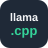

## 👩‍💻 About me

- 🎓 **B.Tech CSE graduate**, specialized in **Artificial Intelligence & Machine Learning**
- 🛰️ AI/ML Intern at **NRSC, ISRO (Kolkata)**: applied remote sensing, data analysis and satellite image fusion
- 💼 AI/ML Engineer & web developer at **Digital Sparrow**, and co-founder of **[SeedLaunch](https://seedlaunch.co)**
- 🤖 Building end-to-end solutions that combine ML with real-world applications
- 🐧 Comfortable on Linux and with full-stack development
- 📚 Always learning new AI techniques
- 📍 Based in India
- 📫 Reach me at **nandp000@gmail.com**

## 🛠️ Tech stack

**Languages**

**AI / ML & data**

**AI tools & runtimes**

**AI models**

**Data visualisation**

**Web**

**Databases**

**Tools**

Also: Piper TTS, faster-whisper, GeoPandas, Flask-SocketIO, BeautifulSoup

## 🚀 Featured projects

| Project | What it does |
|---|---|
| [newsscrapper](https://github.com/phimatrix/newsscrapper) | News scraper and summarizer with analysis, text-to-speech and a web interface |
| [movie-recommendation-system](https://github.com/phimatrix/movie-recommendation-system) | Movie recommendations in Python with a web app and dataset |
| [voice-assistant-chatbot](https://github.com/phimatrix/voice-assistant-chatbot) | Local voice assistant: faster-whisper speech-to-text, Ollama replies, Piper speech |
| [Automated_blog_system](https://github.com/phimatrix/Automated_blog_system) | Company website with an AI blog generator that writes and publishes SEO posts |
| [newhomepage](https://github.com/phimatrix/newhomepage) | SeedLaunch homepage (seedlaunch.co) in HTML on GitHub Pages |
| [gesturecontrol](https://github.com/phimatrix/gesturecontrol) | Mouse control using eye and hand tracking |
| [GEEproject](https://github.com/phimatrix/GEEproject) | Google Earth Engine pipeline with AOI files, config and scripts |
| [chatbot2](https://github.com/phimatrix/chatbot2) | Python chatbot with text and voice modes |
| [memegenerator](https://github.com/phimatrix/memegenerator) | Website that generates memes, jokes, quotes and riddles |
| [financial-report-generator](https://github.com/phimatrix/financial-report-generator) | React and Chart.js financial report generator |
| [Adwaita-dark-red_Theme](https://github.com/phimatrix/Adwaita-dark-red_Theme) | Dark red Adwaita theme for GTK 3, GTK 4 and Xfce |

## 📊 GitHub stats

  
  
   
  

## 🐍 Contribution snake

  <picture>
    <source media="(prefers-color-scheme: dark)" srcset="https://raw.githubusercontent.com/phimatrix/phimatrix/output/github-snake-dark.svg" />
    <source media="(prefers-color-scheme: light)" srcset="https://raw.githubusercontent.com/phimatrix/phimatrix/output/github-snake.svg" />
    
  </picture>

